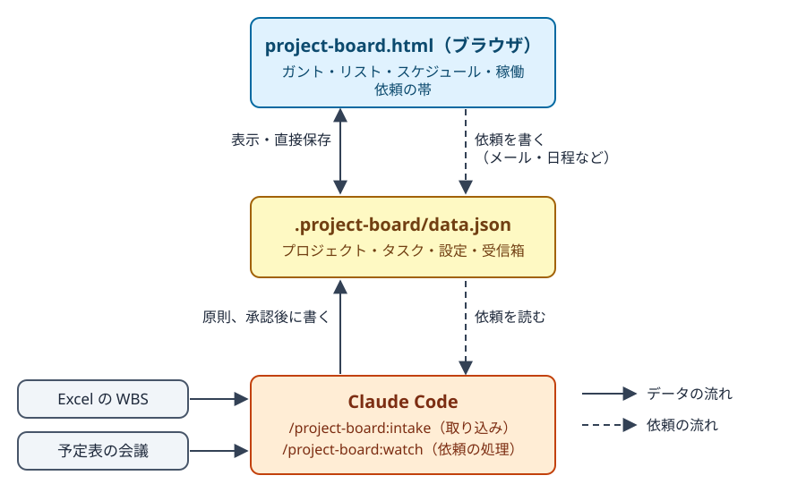
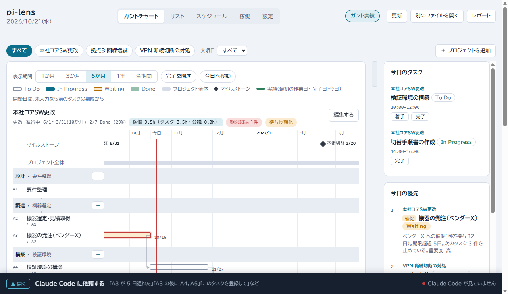
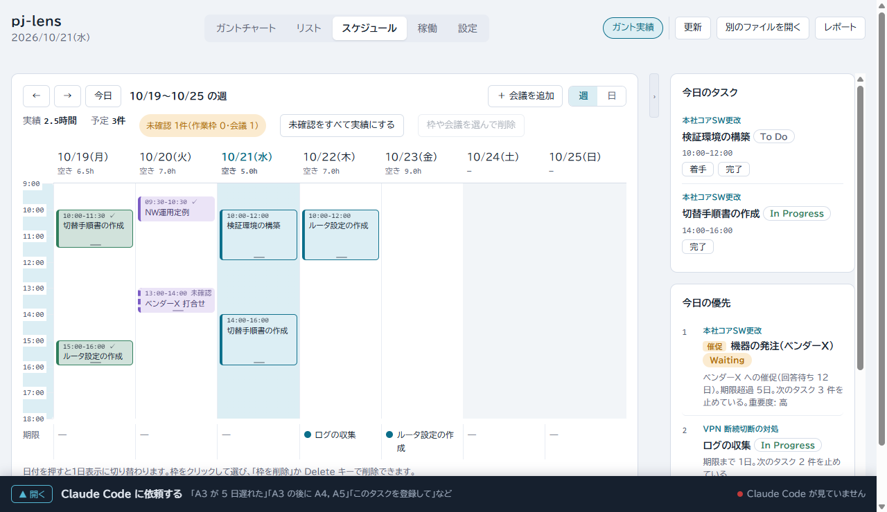
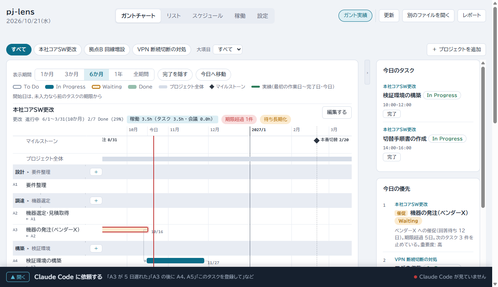
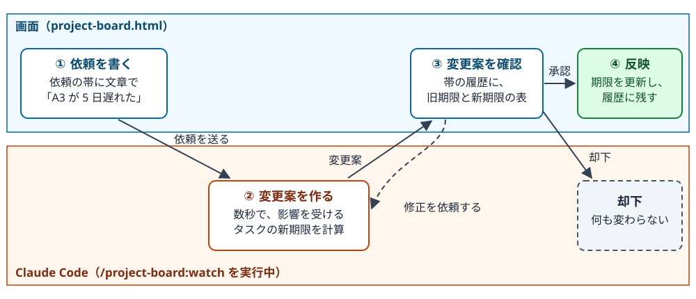
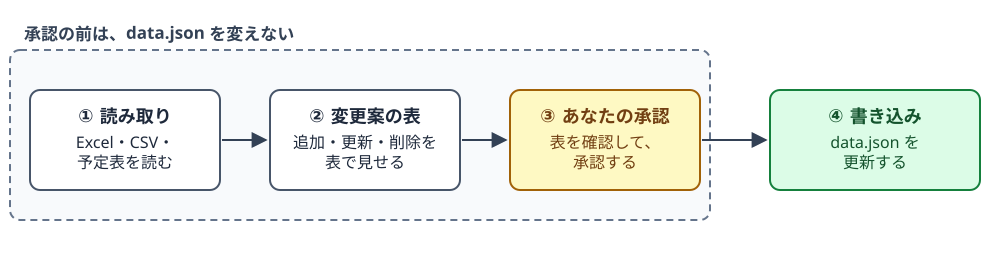

# project-board

ネットワーク設備の管理者が、複数のプロジェクトと自分のタスクを 1 枚の画面で管理する Claude Code プラグインです。Windows 専用です。

データは 1 つの JSON ファイル（`data.json`）、画面は 1 枚の HTML（`project-board.html`）です。



*図 1: 全体図。画面（project-board.html）は、data.json を表示して直接保存します。Excel・予定表の取り込みと、依頼の帯から届く依頼の処理は、Claude Code が受け持ちます。*

## 機能

| 機能 | できること |
|---|---|
| 一覧と今日の優先 | 複数プロジェクトの進捗を、ガントチャートとリストで見て、今日やるタスクを点数順に並べます。 |
| 日程の調整 | 1 つのタスクはバーのドラッグで、前後にまたがる変更は依頼の帯に文章で頼んで変えます。 |
| 取り込み | Excel の WBS・予定表の会議・メール・議事録・メモを、変更案にして取り込みます。 |
| スケジュールと稼働 | タスクの作業枠を予定表に置き、プロジェクト別に作業と会議の時間を集計します。 |

- **今日の優先**: 期限・次のタスクを止めている数・重要度から点数を付け、理由と一緒に並べます。遅延はバッジで知らせます。
- **依頼の帯**: 画面下端の帯「Claude Code に依頼する」です。依頼を書くと変更案が出て、承認すると反映します。

1 人で使う前提です。複数人が同じ `data.json` を同時に編集する用途は想定していません。

## 前提条件

| 項目 | 内容 |
|---|---|
| OS | Windows |
| Claude Code | 必須です。 |
| Node.js | 24 以上が必須です。外部のパッケージは使いません。 |
| ブラウザ | Microsoft Edge（または Chrome）を使います。 |
| Python 3.8 以上 | Excel の WBS を取り込むときだけ使います。標準ライブラリの venv と ensurepip が要ります（システムに入れるときは pip）。「取り込み」の「Excel 用の Python ライブラリ」を参照。 |
| ネットワーク接続 | 祝日の取得と、Excel 用パッケージの取得のときだけ使います。 |

ネットワークを使う場面は、次の 2 つです。

- **祝日の取得**（内閣府の祝日一覧）: 営業日で期限を置くときと、`/project-board:watch` を始めるとき。
- **Excel 用パッケージの取得**（PyPI）: システムの Python に使える openpyxl が無いときに、Excel の WBS を初めて取り込むとき。

足りないものは、`/project-board:doctor` で調べられます（「導入方法」の「動作環境の確認」を参照）。

## 導入方法

### 1. プラグインを入れる

入れ方は 2 つです。どちらも、入れたあとの使い方は同じです。

| 方法 | マーケットプレイスの登録元 | 向いている場面 |
|---|---|---|
| A. GitHub から入れる | GitHub のリポジトリ `asama0101/project-board` | 通常の導入。最新版の確認が `/project-board:doctor` で出ます |
| B. ダウンロードして入れる | ローカルに置いた、このリポジトリのフォルダ | Claude Code から GitHub へ接続できないとき。版を固定したいとき |

#### 方法 A. GitHub をマーケットプレイスに登録して入れる

Claude Code で、次の 2 つを実行します。1 つ目で GitHub のリポジトリをマーケットプレイスとして登録し、2 つ目でプラグインを入れます。

```
/plugin marketplace add asama0101/project-board
/plugin install project-board@project-board
```

#### 方法 B. ローカルにダウンロードして入れる

1. このリポジトリをダウンロードします。次のどちらかを選びます。
   - git を使う: 好きな場所に clone します（例: `D:\tools\project-board`）。
     ```
     git clone https://github.com/asama0101/project-board.git D:\tools\project-board
     ```
   - git を使わない: GitHub のリポジトリ画面で「Code」→「Download ZIP」を選び、ZIP を展開します。展開してできたフォルダの中に、`.claude-plugin` フォルダがあることを確かめます。
2. Claude Code で、ダウンロードしたフォルダ（`.claude-plugin` フォルダがある階層）をマーケットプレイスとして登録し、プラグインを入れます。

```
/plugin marketplace add D:\tools\project-board
/plugin install project-board@project-board
```

ダウンロードしたフォルダは、入れたあとも消さずに置いてください。更新するときに、このフォルダを読み直します。

### 2. 初回の準備

管理したいプロジェクトのフォルダで Claude Code を開き、次を実行します。

```
/project-board:init
```

試すだけなら、末尾に `--sample` を付けます（架空のサンプルデータが入ります）。

```
/project-board:init --sample
```

**すでに `project-board.html` があるときは、新しい版に置き換わり、元に戻せません。** 画面を手で直していたときは、先にコピーを取ってください。`data.json` は変わりません。

次のように出ます（`--sample` のときは、1 行目の末尾に「（サンプルデータ）」が付きます）。

```
.project-board/data.json: 作りました
project-board.html: 作りました
.gitignore: 変更しませんでした（この場所も親のフォルダにも .git がないため、.gitignore は変更しません）

次の手順: ブラウザで project-board.html を開き、「ファイルを開く」で .project-board/data.json を選びます。
```

続けて、画面で 2 つ操作します。

1. `project-board.html` を Edge か Chrome で開き、「ファイルを開く」で `.project-board/data.json` を選びます。以後、画面での変更は、このファイルに直接保存されます。
2. 「＋ プロジェクトを追加」から登録します。名前・開始・期限・状態を直します。既定は、開始が今日、期限が今日の 30 日後、状態が「計画中」です。

タスクは、ガントとリストの見出し行の「＋」から足せます。Excel の WBS を取り込む（「取り込み」）か、依頼の帯で頼む（「頼めること」）こともできます。

次回からは、`project-board.html` を開くだけで、前回のファイルが開きます。アクセス許可の確認が出たときは、開始画面の「前回のファイル（ファイル名）を開く」を押します。別のファイルにするときだけ、「別のファイルを開く」を押します。

- `/project-board:init` は、何度実行しても安全です。既存の `data.json` は変えません。
- 同名の別ファイル `project-board.html` があるときは、何も作らずに止まります。
- サンプルの日付は 2026 年 10 月前後です。ブラウザのアドレス欄で、`project-board.html` の URL の末尾に `?today=2026-10-20` を付けると、期限超過だらけになりません。

### 作られるファイル

| パス | 内容 |
|---|---|
| `project-board.html` | ダッシュボード（プラグインに同梱の完成版のコピー） |
| `.project-board/data.json` | あなたのデータ |
| `.gitignore` の `.project-board/` の 1 行 | そのフォルダか親フォルダに `.git` があるときだけ追記します。UTF-8 以外の `.gitignore` は触らず、追記を案内します |

### 更新

Claude Code の `/plugin` 画面で、project-board を更新します。方法 B で入れたときは、先にフォルダを新しい版に差し替えます（git なら `git pull`、ZIP なら展開し直し）。そのあと、使っている作業フォルダごとに `/project-board:init` を実行します。画面（`project-board.html`）だけが新しい版になり、`data.json` は変わりません。

### 動作環境の確認

別の PC で使い始めるときや、動かないときは、Claude Code で `/project-board:doctor` を実行します。次の 6 項目を調べて、足りないものと対処の手順を表示します。何も変更しません。

| 項目 | 区分 |
|---|---|
| Node.js 24 以上 | 必須 |
| 保存先（フォルダで、書き込めること） | 必須 |
| project-board の版（GitHub をマーケットプレイスに登録しているときは、最新かも確認） | 任意 |
| 祝日一覧（内閣府）への接続 | 任意 |
| Excel の読み取り（Python・pip・openpyxl） | 任意 |
| 予定表の MCP の指定 | 任意 |

任意の項目は、使う機能のときだけ要ります。祝日は営業日で期限を置くときと `/project-board:watch` を始めるとき、Excel は WBS の取り込み、予定表の MCP は予定表の取り込みです。

項目ごとに `[OK]`・`[要対処]`・`[任意]` と、`→` で始まる対処の手順が出ます。必須の項目が足りないと、終了コード 3 で終わります。任意の項目だけが足りないときは、0 です。祝日一覧と GitHub の最新の版へは接続を試すだけで、データは何も送りません。新しい版があるときは、更新の手順（`/plugin marketplace update` と `/plugin update`）が出ます。

Claude Code を使わずに調べたいときは、次のコマンドを実行します。

```
node "<プラグインの場所>/tools/doctor.js" --data "<保存先>"
```

`<プラグインの場所>` は、プラグインを入れたフォルダ（`~/.claude/plugins/` の下）です。`<保存先>` は、`~/.claude/plugins/data/` の下の project-board 用フォルダです。場所は環境により異なります。Excel の読み取りだけを調べるときは、`tools/xlsx.js` に `doctor` を付けて、同じ引数で実行します。

<details>
<summary>SharePoint Online に置いた data.json を使う（動作は未確認）</summary>

`data.json` をローカルに置けないときは、SharePoint Online のドキュメントライブラリをネットワークドライブに割り当てて、そこに置いた `data.json` を開きます。https の URL は、「ファイルを開く」で指定できません。

**この方法は、動作を確かめていません。** 先に `data.json` のコピーで試してください。

1. エクスプローラーで「PC」を右クリックし、「ネットワークドライブの割り当て」を選びます。
2. 「フォルダー」にドキュメントライブラリの URL を入れて、ドライブを割り当てます。
3. 割り当てたドライブに `data.json` を置きます。
4. `project-board.html` の「ファイルを開く」で、そのドライブの `data.json` を選びます。

画面での編集と保存を想定しています。Claude Code のコマンド（取り込み・`/project-board:watch`）が、このドライブの `data.json` を扱えるかは、確かめていません。

</details>

### アンインストール

**プラグインを削除すると、`~/.claude/plugins/data/` の下の、次の 2 つが消えます。**

- Excel 用の Python パッケージを入れた専用の venv（`venv` フォルダ）
- 予定表の MCP の指定 `project-board-mcp.json`

```
/plugin uninstall project-board@project-board
```

次のものは、残ります。不要なら、手で消してください。

- 作業フォルダの `.project-board/data.json`・`project-board.html`
- システムの Python のユーザー領域に入れた openpyxl（`pip uninstall openpyxl` で消せます）

再インストールしたときは、消えた 2 つをもう一度作ります。`venv` は Excel の取り込み時の承認で、MCP の指定は `/project-board:mcp` で作ります。

## 使い方

最初の例（コマンドと出力）は、導入方法の「初回の準備」にあります。使い方は、3 つの流れです。

| 流れ | Claude Code | いつ使うか |
|---|---|---|
| 毎朝の流れ | 使わない | 今日やることを決めて、着手にする |
| 依頼の帯から頼む | `/project-board:watch` を実行しておく | 外部要因で日程が動いた、タスクを足したい |
| 取り込み | `/project-board:intake` を使う | Excel の WBS・予定表の会議を入れる |

コマンドの実行時に、Claude Code が許可を確認することがあります。このプラグインのコマンドなので、許可して構いません。

### 毎朝の流れ

`project-board.html` を開いて、今日やることを決め、着手にします。次の画像は、サンプルデータ（`/project-board:init --sample`）に「検証環境の構築」の作業枠（10:00〜12:00）を 1 つ足したものです。日付は 2026-10-21 にしています。

1. **「今日の優先」を見る。** `project-board.html` を開くと、ガントチャートの画面になります。右側の「今日の優先」に、上位 4 件が点数の高い順で並びます。理由も一緒に出ます。「今日のタスク」には、今日に作業枠があるタスクが並びます。

   

2. **今日やるタスクを、時間枠に置く。** 上部の「スケジュール」を開きます。「今日の優先」のタスクを、カレンダーの今日の列へドラッグします（15 分刻み・長さ 1 時間）。置いたタスクは、「今日のタスク」に出ます。

   

3. **「着手」を押す。** 「今日のタスク」で、取りかかるタスクの「着手」を押します。状態が To Do（または Waiting）から In Progress に変わり、ガントのバーが濃くなります。変更は、その場で `.project-board/data.json` に保存されます。終わったら「完了」を押します。

   

### 依頼の帯から頼む

前後のタスクにまたがる変更（外部要因で日程が動いたとき）は、依頼の帯に文章で頼みます。次の図の順に進みます。



*図 2: 依頼の帯から日程を変える流れ。*

1. `project-board.html` があるフォルダで Claude Code を開き、`/project-board:watch` を 1 回実行して、見張りを始めます。見張っている間、帯に「Claude Code が見ています」と出ます。
2. 帯を開いて、対象のプロジェクトを選びます。依頼を書いて、「依頼を送る」を押します。

   ```
   A3 が 5 日遅れた（原因: ベンダー）
   ```

   「A3 が 5 日遅れた。影響を見て」のような、普通の言葉でも動きます。原因が読み取れないときは、変更案の「原因」の選択欄に「その他」と出ます。違うときは、承認の前に「修正を依頼する」で伝えます。
3. 数秒で、帯の履歴に変更案の表が出ます。確認して、「承認して反映する」を押します。却下もできます。

サンプルデータでは、次の表が出ます。次のタスクの A4 は、期限に余裕があるので動きません。

| タスク | 件名 | 旧期限 | 新期限 | 理由 |
|---|---|---|---|---|
| A3 | 機器の発注（ベンダーX） | 2026-10-16 | 2026-10-21 | 指定（+5日） |

動作の決まりは、次のとおりです。

- **承認するまで、タスクの期限は変わりません。** 依頼の記録だけが、`data.json` に書かれます。
- 次のタスクが動くときは、その行も表に並びます。プロジェクト期限を超えるときは、警告が付きます。前倒しのときは、「次のタスクも詰めて」と書いたときだけ、次のタスクも詰めます。
- 承認すると、期限が更新され、原因と理由が日程変更の履歴に残ります。承認は、画面の「承認して反映する」か、`/project-board:watch` を動かしている端末での「R3 を承認」でできます。
- 画面は、Claude Code がデータを直したあと自動で読み直します。すぐに見たいときは、上部の「更新」を押します。履歴は最新の 20 件で、完了したものから消えます。
- 見張りは 30 分ごとに終わり、Claude Code が自動で張り直します。帯が「見ていません」になったときは、`/project-board:watch` をもう一度実行します。見張りが止まっている間、依頼は処理されません。止めるときは、Claude Code に「見張りをやめて」と伝えます。

#### 頼めること

| やりたいこと | 依頼の例 |
|---|---|
| タスクを追加する | 「ルータの増設」に、設置後の疎通確認を 3 営業日で登録して（チェックリストの項目や、前のタスクも付けられます） |
| 日程を変える（遅れ・前倒し） | A3 を 4 日間変更する／A5 を 10 日前倒しして、次のタスクも詰めて |
| メール・議事録・メモを取り込む | 本文を貼って「これを取り込んで」 |

- **依頼で頼めるのは、タスクの登録と、期限の変更だけです。** 状態・重要度の変更、削除、プロジェクトの追加と変更、マイルストーン、チェックリストの項目の変更、前のタスクの付け外しは、画面で行います。依頼に書くと、「画面で行ってください」と返ります。
- 期限の移動と、営業日で期限を決める登録（「A4 の 3 営業日後に作業を登録」）は、同じ依頼にできません。先に期限の移動を頼んで、承認してから、登録を頼みます。期限を日付で指定する登録（「A5 を 12/25 期限で登録」）は、一緒に頼めます。

### 取り込み

`/project-board:intake` で、Excel の WBS・予定表の会議・会議のプロジェクト規則を取り込みます。どれも次の順で進み、承認の前は、データを変えません。



*図 3: 取り込みの流れ。*

例外は、`/project-board:watch` を動かしている間の予定表の会議です。承認の確認なしで更新します（詳細は下の「予定表の取り込みの詳細」）。

| コマンド | 内容 |
|---|---|
| `/project-board:intake wbs <ファイル> [プロジェクト]` | Excel（または CSV）の WBS を、タスクとして取り込みます |
| `/project-board:intake calendar [期間]` | 予定表の会議を取り込みます |
| `/project-board:intake rules` | 会議のプロジェクト規則（件名のキーワード → プロジェクト）を見る・変える |

#### Excel 用の Python ライブラリ

Excel の WBS を取り込むときだけ、openpyxl 3.1.5・et_xmlfile 2.0.0・defusedxml 0.7.1 を使います。CSV の取り込みと、画面・予定表・依頼の帯には要りません。

システムの Python に openpyxl（3.1 系）・et_xmlfile・defusedxml が入っていれば、それを使います。入っていなければ、承認を求めたうえで、入れ先を選んで入れます。

| 入れ先 | 内容 |
|---|---|
| 専用の venv（`<保存先>/venv`・推奨） | システムの Python を変えません。 |
| システムの Python のユーザー領域 | `pip install --user` で入れます。すでにある別の版の openpyxl は、固定した版に置き換わります。 |

承認しない、または Python が無いときは、Excel を CSV に保存してください。Python なしで取り込めます。

この Python に標準ライブラリの venv と ensurepip が無いときは、venv を作れません。システムに入れる（pip が要ります）か、Excel を CSV に保存してください。`<保存先>/venv` が既にあって使えないとき（壊れた venv、版の違う venv、自分の venv など）は、消さずに止まります。project-board が作ったものなら、そのフォルダを消してから、もう一度実行してください。

<details>
<summary>WBS の取り込みの詳細</summary>

- WBS の列の意味は、Claude が判断し、対応表を見せて確認を取ります。承認された対応表は、プロジェクトごとに保存され、次回は確認だけです。
- 再取り込みでは、同じ項目を更新します。画面で直した件名は、上書きしません。

</details>

<details>
<summary>予定表の取り込みの詳細</summary>

- 先に `/project-board:mcp` で、使う MCP（例: Outlook）を指定します。MCP は、このプラグインに同梱していません。先に Claude Code に用意してください。
- 見張り（`/project-board:watch`）の間は、予定表の会議が、承認の確認なしで自動で更新されます。追加と、終わっていない未確認の会議の更新・削除が対象です。更新の結果は、見張りの画面（端末）に 1 行で出ます。
- 終わった会議と確認済みの会議は、実績になるので、予定表から消えても、変わっても、そのまま残ります。予定表の取得が 0 件のときは、削除しません。
- 自分だけの予定と、自分と会議室だけの予定は、会議として取り込みません。変更案の表に「対象外 N 件」と出ます。判定には、`/project-board:mcp` で、自分のメールアドレスを設定します（未設定のときは、何も除きません）。
- 取り込み済みの該当の予定は、次の取り込みで「削除」に出ます。確認済み（実績に数えている）の会議は、変更案で注意が付きます。参加者が分からない予定は、取り込みます。

</details>

### コマンド一覧

| コマンド | 使いどころ |
|---|---|
| `/project-board:doctor` | 動作環境の診断（足りないものと対処を表示する。何も変更しない） |
| `/project-board:init` | セットアップ（`--sample` でサンプルデータ入り） |
| `/project-board:intake` | Excel の WBS・予定表の会議の取り込み、会議のプロジェクト規則 |
| `/project-board:mcp` | 予定表で使う MCP の指定（`show`・`calendar`） |
| `/project-board:watch` | 依頼の帯から届く依頼を、見張って処理する |

`/project-board:watch` は、始めるときと 30 分ごとの再起動時に、予定表の会議を更新します（予定表の MCP を指定しているとき）。始めるときに、日本の祝日も、必要なら更新します。

### 画面の見方

ナビは、ガントチャート・リスト・スケジュール・稼働・設定の 5 つです。

| 画面 | 内容 |
|---|---|
| ガントチャート | プロジェクトで絞り込み、タスクの期間をバーで見ます。 |
| リスト | ガントチャートと同じ絞り込みで、タスクを表で見て編集します。 |
| スケジュール | 週／日の予定表に、タスクの作業枠と会議を置きます。 |
| 稼働 | 週／月ごとに、プロジェクト別のタスクと会議の時間を集計します。 |
| 設定 | 営業日の数え方・勤務時間・日本の祝日・休み・会議名のキーワード規則を扱います。 |

- スケジュールでは、「今日の優先」のタスクをドラッグして、作業枠を置きます。会議は、手入力するか、予定表から取り込みます。過ぎた枠・会議は、「実績にする」で確定します。
- 稼働は、確認済みのものだけを数えます。
- 設定の節は、見出しを押して折りたためます。

<details>
<summary>ガントチャートの操作</summary>

- 土日・祝日・休みの日付の列に、色が付きます。
- 重要度が「高」のタスクは、行が薄い赤になり、左端に太い赤の縦線が付きます。完了・中止したタスクには付きません。
- 前のタスクがあるタスクには、前のタスクの右端から矢印が引かれます。バーにマウスを置くと、そのタスクが青、前のタスクが橙、次のタスクが緑になります。
- バーをドラッグすると、日付を変えます。左端で開始日、右端で期限、中ほどで両方です。前後のタスクは確認せず、そのタスクだけが動きます。開始日を指定したタスクは、前のタスクの期限が変わっても動きません。
- タスク名またはバーをクリックすると、編集の窓が開きます。件名・状態・開始日・期限・前のタスク・重要度・メモを直せます。
- タスクの行頭の「⠿」をドラッグすると、タスクの並びを変えます。別の大項目・中項目の行へ落とすと、そのタスクの大項目・中項目も付け替わります。同じプロジェクトの中だけ動かせます。リストでも同じ操作ができます。
- 本体と右側の境界線の「‹ ›」で、右側の「今日のタスク」「今日の優先」を、閉じたり開いたりします。

</details>

## 設定

設定は「設定」タブで変えられます。変更は、その場でファイルに保存されます。`.project-board/data.json` の `settings` に、直接書くこともできます。省略した項目は、既定値になります。形が違う値は、「設定」タブの項目の横に注意が出ます。節を閉じているときは、見出しに「注意 N 件」が出ます。

「設定」タブの節は、次の 4 つです。

- 基本の設定: 営業日の数え方・勤務時間・待ち長期化の日数・見出しの呼び名
- 休みと営業日: 日本の祝日（表示のみ）・休み（手動）・営業日として扱う日
- キーワード規則（会議名）
- WBS の取り込み記録（表示のみ）

| 項目 | 内容 | 既定 |
|---|---|---|
| `workday` | 勤務時間（`start`・`end`、`HH:MM` 形式） | 09:00〜18:00 |
| `countWeekendsAndHolidays` | `true` のとき、土日と日本の祝日を営業日として数える | `false` |
| `waitingLongDays` | `Waiting` を「待ち長期化」とみなす日数 | 7 |
| `labels` | 見出しの呼び名（`group`・`subgroup`） | 大項目・中項目 |
| `projectRules` | 会議のプロジェクト規則（`keyword`・`projectId`） | なし |
| `holidays` | 手動の休み（`date`・`kind`＝祝日／有給／その他・`note`） | なし |
| `workdays` | 営業日として扱う日（`date`・`note`）。例: 休日出勤 | なし |
| `nationalHolidays` | 取得した日本の祝日（自動で取得します） | なし |

営業日の計算とスケジュールの作業枠は、土日・日本の祝日・手動の休みを飛ばします。「営業日として扱う日」に指定した日は、これらの日でも営業日として数え、作業枠も置けます。

- `countWeekendsAndHolidays` を `true` にすると、土日と日本の祝日を飛ばさず、営業日として数えます。手動の休みは、`true` のときも飛ばします。仕事用とプライベート用で `data.json` を分けて使うときの設定で、「基本の設定」の「営業日の数え方」で切り替えます。
- `nationalHolidays` は、営業日で期限を置く依頼のときと `/project-board:watch` を始めるときに、未取得・古い・範囲外なら、内閣府の祝日一覧から自動で取得します。`countWeekendsAndHolidays` が `true` のときは、取得しません。

直接書くときの例です。

```json
"settings": {
  "workday": { "start": "08:30", "end": "17:30" },
  "waitingLongDays": 5,
  "labels": { "group": "フェーズ", "subgroup": "作業" },
  "projectRules": [{ "keyword": "ベンダーX", "projectId": "A" }]
}
```

画面右上の「ガント実績」のスイッチ、右側の「今日の優先」の開け閉め、「設定」タブの節の開閉は、このブラウザに保存されます。

## 困ったとき

| 画面や端末に出る症状 | 対処 |
|---|---|
| 保存時に「他で更新されました。再読込してください」と出る | 他の手段で `data.json` が更新されました。上部の「更新」で読み直します（下の注意を先に読みます）。 |
| 毎回ファイルを選ぶ必要がある。「前回のファイルの記憶を読めませんでした」と出る | このブラウザが記憶を許していません。シークレットウィンドウや、サイトデータを終了時に消す設定が原因です。通常のウィンドウで開きます。 |
| 「このブラウザはファイルへの直接保存に対応していません。読み込みだけできます」と出る | 直接保存に対応しないブラウザです。Edge か Chrome で開きます。画面上部の「JSON を書き出す」で保存することもできます。 |
| `/project-board:init` が「何も変更せずに止めました」と出る | 同名の別ファイル `project-board.html` があります。名前を変えるか移動してから、もう一度実行します。 |
| 帯が「見ていません」になっている | `/project-board:watch` を実行します。見張りが止まっている間、依頼は処理されません。 |
| 読み込み時に「注意: settings.…」と出る | `settings` の値の形が違います（例: 勤務時間が `9:00`）。「設定」タブで直せる項目は、そこで直します。それ以外は、`.project-board/data.json` を上の例の書式に合わせて直します。勤務時間が `HH:MM` でないと、スケジュール画面が動きません。 |
| 「Excel を読むための openpyxl が、システムの Python にも専用の venv にもありません」と出る | 入れ先を選んで承認すると、入れられます（「取り込み」の「Excel 用の Python ライブラリ」を参照）。入れられないときは、Excel を CSV に保存して取り込みます。 |
| `/project-board:doctor` に `[要対処]` と出る。別の PC で動かない | `→` で始まる手順に、上から従います。 |

「他で更新されました」は、画面の変更を自動で当て直せなかったときに出ます。上書きはしません。**読み直すと、画面の保存できていない変更は消えます。** 残したいときは、先にバナーの「変更を JSON で書き出す」で退避します。

## ライセンス

MIT（[LICENSE](LICENSE)）
